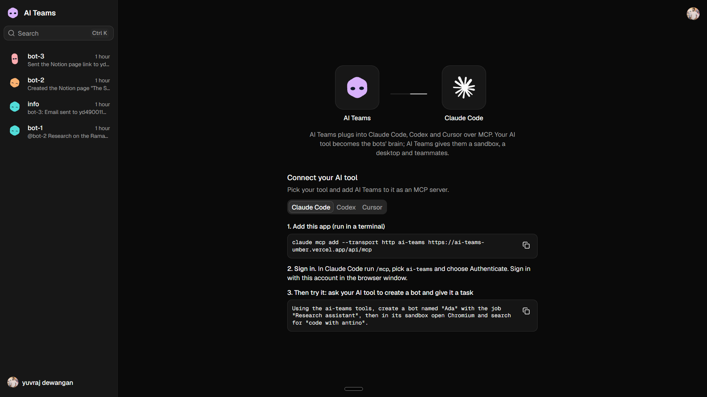

# AI Teams



AI Teams is a web dashboard plus an **MCP server**. You create AI "bots" (teammates). Each bot gets its own private Linux desktop sandbox. You then drive the bots **from your own AI tool** (Claude Code, Codex or Cursor), which connects to this app over MCP.

**This app makes no AI call of its own.** Your AI tool's model is the bot's brain. The app only:

1. stores bots, chats and messages,
2. hands out a bot's persona (system prompt),
3. runs the bot's sandbox tools (shell, files, mouse, keyboard, screenshots),
4. lets bots act in your other apps (Gmail, Slack, Notion, ...) through Pipedream,
5. shows the conversation and the bot's live desktop in a web page.

## How it works

```
Claude Code / Codex / Cursor
        |  MCP over HTTP  (OAuth sign-in through Clerk)
        v
/api/mcp  (Next.js route, mcp-handler)  --->  Neon Postgres (Drizzle)
        |            |
        |            +--->  Pipedream Connect  --->  Gmail / Slack / Notion ...
        v
Daytona sandbox (one per bot: Linux + XFCE desktop + Chromium + VNC)
        ^
        |  noVNC iframe
Web dashboard (Next.js 16, React 19, shadcn/Base UI)  <---  Clerk sign-in
```

## Features

- Sign up / sign in with Clerk
- Create bots (name, job, instructions, DiceBear avatar) through MCP
- One-on-one chat per bot, and group chats of several bots with `@mentions`
- Live chat transcript, sidebar with search (Cmd/Ctrl+K)
- Live desktop panel (noVNC) showing what the bot is doing
- Per-bot sandbox with idle auto-stop (5 min) and auto-restart on next use
- Per-bot memory file (`~/MEMORY.md`)
- Bots can act in Gmail, Slack, Notion, etc. through Pipedream
- Error reporting with Sentry

### MCP tools (27)

| Group | Tools |
|---|---|
| Bots | `list_bots`, `get_bot`, `create_bot`, `log_chat_message` |
| Groups | `create_group`, `add_bot_to_group`, `list_groups`, `get_group`, `post_group_message`, `read_group_messages` |
| External apps | `connect_app`, `wait_for_app_connection`, `list_connected_apps`, `list_app_tools`, `get_app_tool`, `run_app_tool` |
| Sandbox | `bash`, `readFile`, `writeFile`, `listFiles`, `mouseClick`, `mouseMove`, `mouseScroll`, `keyboardType`, `keyboardPress`, `viewScreen`, `showScreen` |

## Tech stack

| Layer | Choice |
|---|---|
| Framework | Next.js 16.4, React 19.3, TypeScript, Tailwind 4 |
| UI | shadcn + Base UI |
| Auth | Clerk (web sign-in and MCP OAuth) |
| Database | Neon Postgres + Drizzle ORM (schema push only, no migrations) |
| MCP server | `mcp-handler` + `@modelcontextprotocol/server` |
| Sandboxes | Daytona SDK |
| App connections | Pipedream Connect |
| Monitoring / jobs | Sentry, Trigger.dev (optional) |
| Package manager | bun |

## Install and run locally

### 1. Prerequisites

- Node.js 20+ and [bun](https://bun.sh)
- Accounts: [Clerk](https://clerk.com), [Neon](https://neon.tech), [Daytona](https://www.daytona.io), [Pipedream](https://pipedream.com)
- Optional: Sentry, Trigger.dev, Vercel
- An MCP-capable AI tool: Claude Code, Codex or Cursor

### 2. Clone and install

```bash
git clone <your-repo-url> ai-teams
cd ai-teams
bun install
```

### 3. Create `.env.local`

Create a file named `.env.local` in the project root:

```env
# Clerk (required)
NEXT_PUBLIC_CLERK_PUBLISHABLE_KEY=
CLERK_SECRET_KEY=
NEXT_PUBLIC_CLERK_SIGN_IN_URL=/sign-in
NEXT_PUBLIC_CLERK_SIGN_UP_URL=/sign-up
NEXT_PUBLIC_CLERK_SIGN_IN_FALLBACK_REDIRECT_URL=/
NEXT_PUBLIC_CLERK_SIGN_UP_FALLBACK_REDIRECT_URL=/

# Neon Postgres (required)
DATABASE_URL=

# Daytona sandboxes (required)
DAYTONA_API_KEY=
DAYTONA_API_URL=
DAYTONA_TARGET=

# Pipedream Connect (needed for Gmail / Slack / Notion ...)
PIPEDREAM_CLIENT_ID=
PIPEDREAM_CLIENT_SECRET=
PIPEDREAM_PROJECT_ID=
PIPEDREAM_ENVIRONMENT=development

# Optional
NEXT_PUBLIC_APP_URL=
NEXT_PUBLIC_SENTRY_DSN=
SENTRY_DSN=
SENTRY_AUTH_TOKEN=
TRIGGER_SECRET_KEY=
```

Where to get the values:

| Variable | Source |
|---|---|
| Clerk keys | Clerk dashboard, API keys |
| `DATABASE_URL` | Neon dashboard, connection string |
| `DAYTONA_*` | Daytona dashboard |
| `PIPEDREAM_*` | A Pipedream Connect project |
| Sentry / Trigger.dev | Their dashboards (optional) |

Never commit `.env.local`; it is git-ignored.

### 4. Enable OAuth for MCP in Clerk

MCP clients sign in through Clerk's OAuth. In the Clerk dashboard, enable OAuth applications / dynamic client registration for your instance (check Clerk's current docs for "OAuth applications" if the sign-in from your AI tool fails). Discovery routes live in `app/.well-known/`.

### 5. Push the database schema

This project uses **push only**. Do not generate or run migrations.

```bash
bun run db:push
```

Optionally browse the data with `bun run db:studio`.

### 6. Start the app

```bash
bun run dev
```

Open <http://localhost:3000>, sign up, and you will see the "Connect your AI tool" page.

## Connect your AI tool

The MCP endpoint is `<your-app-url>/api/mcp`. Locally that is `http://localhost:3000/api/mcp`. The home page of the app shows the exact commands for your URL.

### Claude Code

```bash
claude mcp add --transport http ai-teams http://localhost:3000/api/mcp
```

Then inside Claude Code run `/mcp`, pick `ai-teams`, choose **Authenticate**, and sign in with the same account in the browser.

### Codex

```bash
codex mcp add ai-teams --url http://localhost:3000/api/mcp
codex mcp login ai-teams
```

### Cursor

Add this to `~/.cursor/mcp.json` (or the project's `.cursor/mcp.json`):

```json
{
  "mcpServers": {
    "ai-teams": { "url": "http://localhost:3000/api/mcp" }
  }
}
```

Then open Settings > MCP and click **Connect** next to `ai-teams`.

> A `localhost` URL only works for AI tools running on your own machine. For cloud-hosted tools, deploy the app and use its public URL (see [Deploy](#deploy)).

The first authenticated call creates your connection record and the "connect" dialog in the dashboard disappears.

## Use the project

Once connected, talk to your AI tool:

> Using the ai-teams tools, create a bot named "Ada" with the job "Research assistant", then in its sandbox open Chromium and search for "code with antino".

The tool returns a chat link. Open it to read the conversation and watch the bot's desktop live (click the thumbnail for fullscreen).

More things to try:

- **Group work:** "Create a group with Ada and Ben, then have Ada research a topic and hand the result to Ben with an @mention."
- **Use an app:** "Using bot Ada, send me an email in Gmail." The tool returns a sign-in link the first time; after you finish signing in, it continues on its own.
- **Run code:** "Have Ada write a Python script in her sandbox and run it."

## Solving common problems

| Problem | Fix |
|---|---|
| AI tool cannot authenticate | Make sure OAuth applications are enabled in Clerk (step 4), the URL ends in `/api/mcp`, and you sign in with the same Clerk account as the dashboard. |
| Dashboard keeps asking you to connect | Run any tool (for example `list_bots`) from your AI tool once so the connection is recorded. |
| `relation ... does not exist` or empty tables | Run `bun run db:push`. |
| Bot sandbox errors or does not start | Check `DAYTONA_API_KEY`, `DAYTONA_API_URL`, `DAYTONA_TARGET`. Sandboxes auto-stop after 5 idle minutes and restart on next use; if mouse/keyboard calls fail right after a stop, retry or restart `bun run dev`. |
| Group chat shows a desktop error | Known issue: the group chat page still tries to show a desktop panel, which groups do not have. |
| Gmail / Slack tools say not connected | Ask the bot to call `connect_app`, open the link, finish sign-in, then retry. Check the `PIPEDREAM_*` variables and that `PIPEDREAM_ENVIRONMENT` matches your Pipedream project. |
| Two bots with the same name in a group | `@mentions` match by name, so keep bot names unique inside a group. |
| Trigger.dev MCP server fails to connect | `.mcp.json` pins `trigger.dev@4.7.4` while the SDK is 4.8.1; update the pin or ignore it (Trigger.dev is optional). |
| Type or build errors | Run `bun run typecheck`, `bun run lint`, `bun run build`. |

## Deploy

1. Create a Vercel project (`vercel link`) and add all environment variables from `.env.local`.
2. Use production keys for Clerk and set `PIPEDREAM_ENVIRONMENT=production` if you use a production Pipedream project.
3. Deploy, then point your AI tool at `https://<your-domain>/api/mcp`.
4. Optional, Trigger.dev: `bunx trigger.dev@latest deploy`.

## Scripts

| Command | What it does |
|---|---|
| `bun run dev` | Start the dev server |
| `bun run build` / `bun run start` | Production build / serve |
| `bun run lint` | ESLint |
| `bun run typecheck` | TypeScript check |
| `bun run format` | Prettier |
| `bun run db:push` | Sync the Drizzle schema to the database |
| `bun run db:studio` | Open Drizzle Studio |

## Project layout

```
app/
  (dashboard)/        sidebar, home page, chat pages
  api/mcp/route.ts    the MCP server
  .well-known/        OAuth discovery for MCP clients
  sign-in/, sign-up/  Clerk pages
actions/              server actions (bot, sandbox, connection)
components/           app components, ui/ (shadcn)
db/                   schema.ts, index.ts (Neon + Drizzle)
lib/                  bot creation, groups, Daytona, sandbox tools, MCP helpers
queries/              data queries for sidebar and chats
trigger/              Trigger.dev tasks (example only)
proxy.ts              Clerk middleware
```

## Working on this project with AI tools

- **Next.js 16 differs from older versions.** Read the guides in `node_modules/next/dist/docs/` before changing routing or caching code. `AGENTS.md` (also loaded by `CLAUDE.md`) tells Claude Code, Codex and Cursor to do this.
- **Database:** only `bun run db:push`. No migrations. This is a development project and data is disposable.
- **Forms:** react-hook-form + zod + a `drizzle-zod` schema from `db/schema.ts`, validated again in a server action.
- **Git:** work on `main`, and commit only when asked.
- **Trigger.dev:** load the matching skill from `.claude/skills/` or `.agents/skills/` before touching Trigger code.
